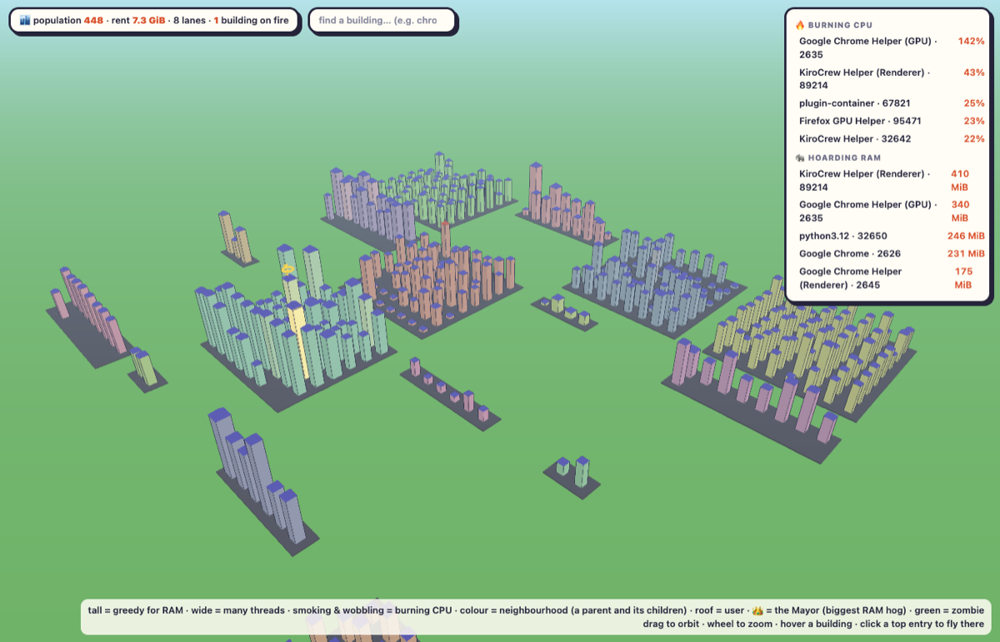

# proccity

Your running processes as a living 3D city. Each building is a process. The city changes as
your system changes: new processes rise out of the ground, dead ones sink, busy ones glow.



- **Height** = resident memory (log scale, so a 10x hog is visibly, not absurdly, taller)
- **Footprint** = thread count
- **Smoke and wobble** = CPU (one full core and the building is visibly having a bad day)
- **Colour** = neighbourhood; **roof colour** = owning user
- **District** = a top-level process and its descendants (a browser and its helpers, a shell
  and what it spawned). Loner processes are pooled into shared "commons" blocks so a typical
  400-process macOS/Linux table is a dense city, not a suburb.
- **Grey** = unseen. A building whose family owns no visible window fades toward concrete.
  What keeps its colour is what you are actually looking at.

Streets are stable: a process keeps its lot for life, a released lot goes to the next
newcomer, and a family's block is released when the family is gone. Type in the search box
to highlight processes by name; click an entry in the 🔥 Burning CPU / 🐘 Hoarding RAM panel
to fly the camera to it. Walk around with the arrow keys or WASD, rotate with Q / E, zoom
with + / −, press H to go home, or use the on-screen D-pad (works on touch). Honours
`prefers-reduced-motion`.

It is deliberately a cartoon: cel-shaded pastel neighbourhoods with ink outlines, pyramid
roofs, a lazy sun and clouds that are three spheres in a trench coat. Buildings burning CPU
wobble and puff smoke. Zombies are green. Newborns bounce; the dead squash and vanish. The
biggest RAM hog wears a spinning crown and is addressed as the Mayor. Every tooltip ends with
an unsolicited opinion.

## Fun things to do with it

- **Watch `npm install` eat your laptop.** Start it, run the install, and watch a new
  neighbourhood sprout hundreds of buildings and then collapse. Oddly satisfying.
- **Find out what Chrome is doing at 3 am.** Type `chrome` in the box. Everything else fades.
  Count the helpers. Reconsider your tabs.
- **Second-monitor screensaver during a long build.** Compilers are a district that grows,
  smokes, and dies. You will know the build finished without alt-tabbing.
- **`kill -9` therapy.** Find the offender in the 🔥 panel, click to fly there, kill it in a
  terminal, and watch the block squash flat. Better than a stress ball.
- **Explain processes to someone who has never seen `ps`.** Parent and children live on the
  same block; threads make a building wide; memory makes it tall; CPU makes it smoke. A five
  year old gets it. Most onboarding docs don't manage that.
- **Spot a fork bomb before it's a problem.** A single neighbourhood filling every lot and
  spilling into a second block is a fork storm. You'll see it a good ten seconds before the
  fan does.
- **Interview prop.** Ask a candidate why one building is tall but not smoking, or wide but
  short. It's a memory / CPU / threads conversation with a picture, and nobody can bluff it.
- **Compare your tools' appetites.** Docker Desktop, the IDE, the browser and the chat app
  each get their own block. Line them up. Judge quietly.
- **Zombie hunt.** Green buildings are processes that exited but whose parent never called
  `wait()`. Find the parent (same block), have a word with its developer.
- **Impress exactly no one at a party** but yourself, at 3 am, watching your machine breathe.

## The report: what is working while you are not looking

The city is the picture; `/report.md` is the list. Every process lands in exactly one of
three buckets:

| Bucket | Meaning |
| --- | --- |
| **On screen** | It, or an ancestor, owns a visible window. A browser's helpers count as on screen because the browser is: you are driving that work. |
| **Unseen & busy** | No window, and right now it is burning CPU (≥ 5 %), moving bytes (≥ 50 KiB/s) or holding ≥ 1 GiB. This is the list worth reading. |
| **Unseen & idle** | No window, nothing much happening. Counted, top 15 by memory listed. |

Each row shows cpu, memory, network rate, **identity**, how many files / sockets / children it
holds, and a *kind* — `user`, `system` or `security` — from a short list of well-known names
(launchd, mDNSResponder, the sync daemons, the usual endpoint agents). The kind is a label for
the reader, not a verdict. The report deliberately never says "dangerous": on a managed Mac the
top unseen talkers are routinely the security agent, the sync daemon and mDNSResponder, all
legitimate, and a tool that flagged them would be wrong far more often than right. It tells you
what is unseen and busy. You decide.

```bash
curl http://127.0.0.1:8765/report.md     # Markdown, paste it anywhere
curl http://127.0.0.1:8765/report.json   # same data, machine-readable
```

### Identity: who signed the running code

Three states, never "safe":

| State | Meaning |
| --- | --- |
| **verified (Apple)** / **verified (TEAMID)** | the code in memory carries a valid signature from Apple or a Developer / App Store team |
| **unverified (ad-hoc / unsigned / invalid)** | it runs, but nobody vouches for it: self-signed, no signature, or modified after signing |
| **unknown** | not checked yet this run, process gone, or a platform with no check |

macOS checks the *running process* with Apple's `codesign` (so a binary swapped on disk after
launch does not fool it), a few processes per sample, unseen-and-busy ones first; the verdict
is cached per process lifetime. Expect your own dev tools to show `ad-hoc` — that is true, and
it is not an alarm. Windows (`WinVerifyTrust`) and Linux (package ownership) are not
implemented yet and report `unknown`; a badge that can be fooled is worse than no badge.

### Files, sockets, children

Counts of what each process holds right now. Not *which* files or *which* peers — the report
shows no paths and no addresses, by contract — just how much. A dash means the OS would not let
this user look (other users' processes on macOS and Linux). Live tracing of what a process
touches when is root on every OS, so proccity does not do it.

### What works where

| Signal | macOS | Windows | Linux X11 | Linux Wayland |
| --- | --- | --- | --- | --- |
| cpu, memory, threads, family | yes | yes | yes | yes |
| on screen vs unseen | yes (`[mac]` extra for every window; frontmost app without it) | yes, no extra dependency | yes, via `/usr/bin/xprop` | **unknown** — no generic window list; everything listed as unseen |
| network rate per process | yes, `nettop`, no root | **needs admin** (ETW) | **needs admin** (`CAP_NET_RAW`) | needs admin |
| identity | yes, `codesign` | unknown (not yet) | unknown (not yet) | unknown |
| files / sockets / children | yes | yes | yes | yes |

Where a signal cannot be measured the report says so — `needs admin`, `unknown`, a dash —
rather than printing a zero that looks like a measurement. Every report opens with a "What this
report could measure here" list for exactly this reason.

Where the numbers come from, and what proccity does to get them:

- **Network rate** — Apple's `/usr/bin/nettop`, per process, no root needed. Two samples,
  difference over elapsed time. Linux and Windows have no per-process counter an ordinary user
  may read, so the column reads `needs admin`.
- **On screen** — macOS: `/usr/bin/lsappinfo front` for the frontmost app (always), and the
  Quartz window list for every app with a visible window (with the optional `mac` extra).
  Windows: `EnumWindows` / `IsWindowVisible` / `GetForegroundWindow` through `ctypes`, no
  dependency; cloaked UWP shells are excluded. Linux X11: `_NET_CLIENT_LIST` and
  `_NET_WM_PID` through `xprop`; minimised windows are not on screen. Window *titles* are never
  requested on any platform.
- **Identity** — `/usr/bin/codesign --verify <pid>` then `codesign -dv <pid>`; the parser
  keeps the signer fields and discards the executable path.
- **Permissions** (camera, microphone, files) — not reported. macOS keeps those in TCC.db,
  which is unreadable without Full Disk Access, and proccity will not ask for that.

## Run

```bash
python3 -m venv .venv && .venv/bin/pip install -e .
.venv/bin/proccity            # or: .venv/bin/python -m proccity
# open http://127.0.0.1:8765/
```

On macOS, add the `mac` extra so the on-screen set covers every visible window rather than
only the frontmost app:

```bash
.venv/bin/pip install -e '.[mac]'      # pyobjc-framework-Quartz, pinned
```

Flags: `--port` (default 8765), `--interval` seconds between samples (default 2), `-v`.

## Security model

The snapshot exposes process names, users and memory for this machine, so:

- The server binds `127.0.0.1` only and has no auth: anything that can reach it is already
  on your machine. Do not put it behind a port-forward.
- Requests whose `Host` header is not loopback get `421`. That defeats DNS rebinding, the one
  way a web page you visit could otherwise read a loopback service as same-origin. The report
  endpoints sit behind the same guard and carry the same headers.
- Static files are served from an allowlist of four paths, not a directory.
- The page ships a Content-Security-Policy (no inline script, no eval) whose `script-src`
  allows only the pinned `three@<version>/` path on the CDN, and the Three.js import map is
  version-pinned with SRI `integrity` hashes for every module the app imports, so the CDN
  cannot swap the code under you. The frontend never uses `innerHTML`.
- Only `GET` and `HEAD` are served; other verbs get `405`, and error pages are plain text.
- Response headers: `Cache-Control: no-store`, `X-Content-Type-Options: nosniff`,
  `X-Frame-Options: DENY`, `Referrer-Policy: no-referrer`.
- **Subprocesses, on a leash.** proccity runs a fixed set of external commands and nothing
  else: `/usr/bin/nettop`, `/usr/bin/lsappinfo` and `/usr/bin/codesign` on macOS (all
  Apple-shipped), `/usr/bin/xprop` on Linux X11. Each is called by absolute path with a literal
  argument list, a timeout and no shell; nothing from the user, the network or a process name
  ever reaches a command line. The values that are fed back into a second command — the
  frontmost app's ASN on macOS, an X11 window id, a pid for `codesign` — must match a strict
  pattern (`ASN:0x…-0x…:`, `0x[0-9a-f]{1,16}`, a positive integer) first, or they are dropped.
  Output is parsed by pure functions with fixture tests. If a tool is missing or slow the result
  is empty, logged once, and the city keeps running. `nettop` is asked for per-process byte
  counts only (`-P`), never for remote addresses; `codesign`'s executable-path line is parsed
  out and discarded. Windows uses `ctypes` against `user32`/`dwmapi` and runs no subprocess.
- **What the report does not contain:** command lines, environment variables, working
  directories, executable paths, window titles, remote addresses, file names. Rows carry pid,
  parent pid, name, user, cpu, memory, rate, threads, status, kind, the reason it was called
  busy, an identity state with its signer (a Team ID or one of `Apple`, `ad-hoc`, `unsigned`,
  `invalid`), and three counts. `tests/test_leakage.py` asserts every row key against that
  allowlist and greps the live report for path, address and environment shapes.

The frontend loads Three.js from unpkg, so the page needs internet on first load. Vendoring
it would remove that dependency; see the review notes for why it is not done yet.

## Test

```bash
.venv/bin/pip install -e '.[dev]'
.venv/bin/ruff check . && .venv/bin/pytest
```

### Pre-push gate

```bash
git config core.hooksPath .githooks     # once per clone
```

`.githooks/pre-push` runs ruff, the test suite, and a
[`cqa-analyzer`](https://pypi.org/project/cqa-analyzer/) gate before every push, each judged
by its exit code. The analyzer runs `--offline` (sockets denied while it works) and compares
against `.cqa-baseline.json`, a file of SHA-256 fingerprints only — no paths, messages or
snippets — so any finding that is not already accepted fails the push. To accept one on
purpose, regenerate the baseline and commit it with the change that introduced the finding;
the diff then shows the acceptance.

`proccity/layout.py` is a pure module (no psutil, no I/O), so the layout tests cover district
grouping, lot stability, block release and reuse, orphan re-parenting, no-overlap, commons
overflow (a family bigger than a block spills into the commons rather than vanishing) and the
log-scaled height without touching a real process table. The server tests start a real
`ThreadingHTTPServer` on an ephemeral port and check the Host guard, the static allowlist,
the security headers, HEAD/405 handling, keep-alive, that the CSP hash still matches the
import map bytes, that every CDN module the app imports has an SRI hash, and that a clean
wheel actually ships every static file (an editable install hides that).

`tests/test_browser.py` loads the page in headless Chrome under the real CSP + SRI and fails
on any console error or policy refusal, then checks the HUD reached "population N". It skips
without a Chrome binary locally; CI sets `PROCCITY_REQUIRE_BROWSER=1` so a missing browser
there is a failure, not a silent skip. The harness first proves it can see a `console.error`
at all, so a clean console means something.

`tests/test_report.py` drives the three buckets over synthetic snapshots: every process lands
in exactly one bucket, helpers of an on-screen app are on screen, thresholds are inclusive,
busy rows say why, idle rows are capped, pipes are escaped, and the JSON shape is fixed.
`tests/test_netio_focus.py` parses captured `nettop` and `lsappinfo` output from fixtures,
checks rate-from-deltas (first sample 0, reused pid ignored, no divide by zero), and proves
both helpers degrade to empty — and never run at all when disabled — on a missing tool, a
timeout or a bad exit. `tests/test_identity.py` classifies real `codesign` output for every state (Apple app, Apple
platform daemon, Developer ID, ad-hoc, invalid, unsigned, gone) and checks the cache is keyed by
process lifetime, the per-tick budget holds, and only a validated integer pid reaches argv.
`tests/test_platforms.py` parses `xprop` output with injected ids, rejects anything that could
smuggle an argument, drives the Win32 filter through a fake enumerator, and proves a Wayland
session is reported `unknown` rather than guessed. Windows and Linux backends are tested at the
parser and filter level only; they have not been run on a real Windows or X11 host yet.
`tests/test_leakage.py` is the stress and no-leak pass: a hundred
concurrent report fetches during live sampling, a thousand sampler ticks with no growth in the
samplers' state, and a report rendered over hostile process names asserting that no command
line, environment variable, path, title or address can appear in either report format.

Review records: [docs/REVIEW-2026-09-29.md](docs/REVIEW-2026-09-29.md) (pass 1, five seats)
and [docs/REVIEW-2026-09-29-pass-2.md](docs/REVIEW-2026-09-29-pass-2.md) (pass 2, six seats).

## Built for fun

A weekend toy inspired by a reel. It shows you what is running unseen; it does not judge it.
For alerts, history and verdicts use `htop`, `btop`, Activity Monitor, or your APM. MIT.
